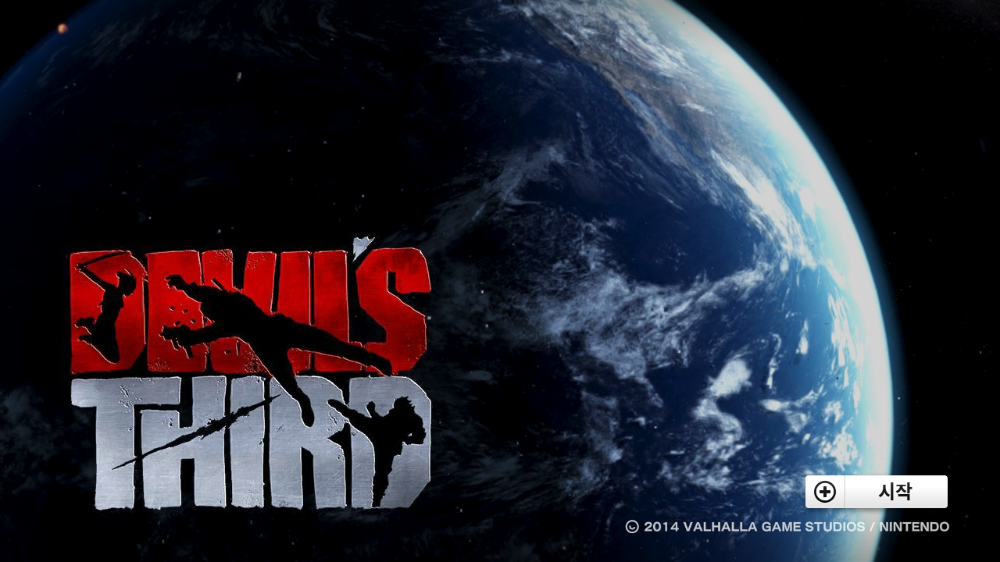
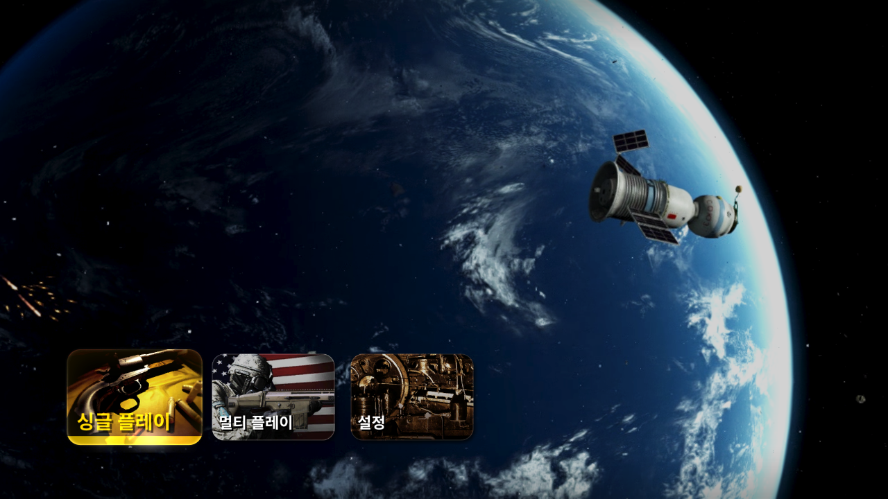
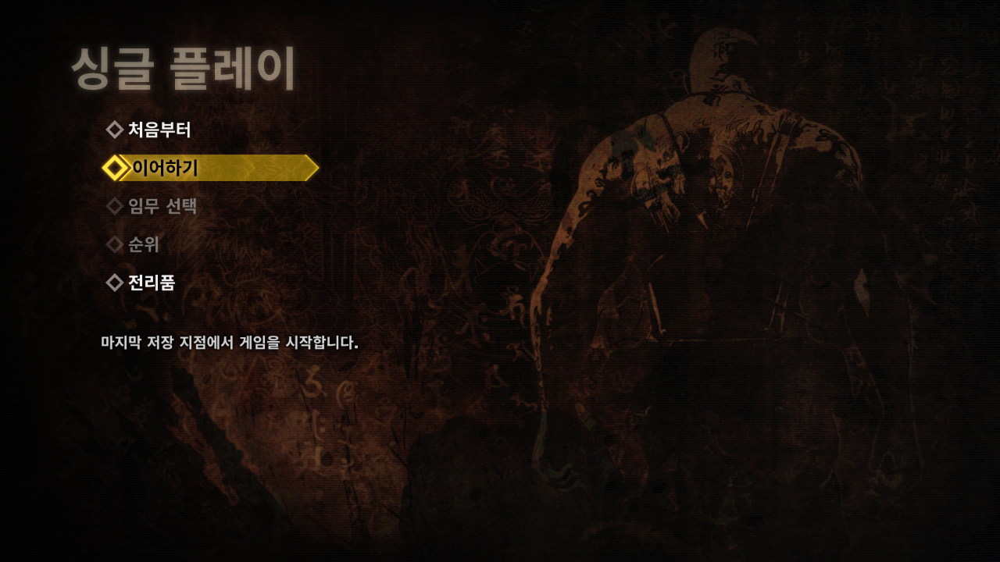
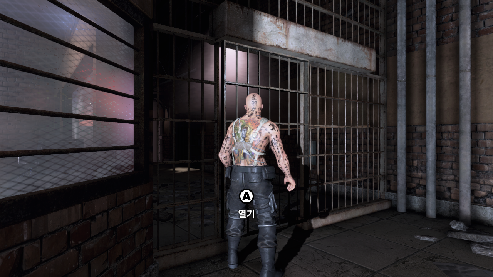
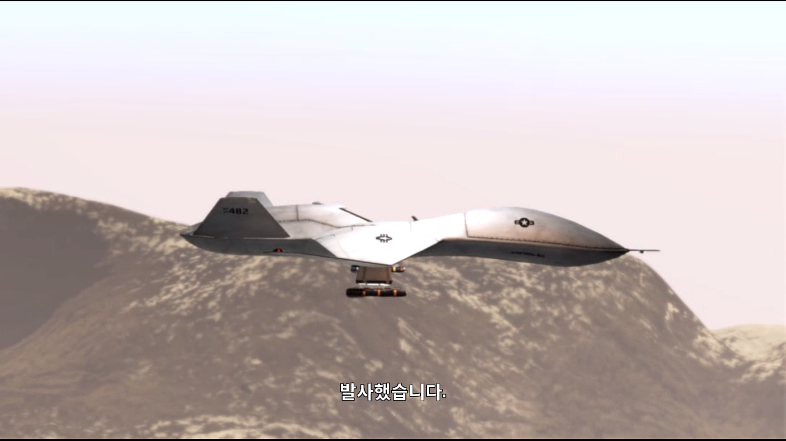
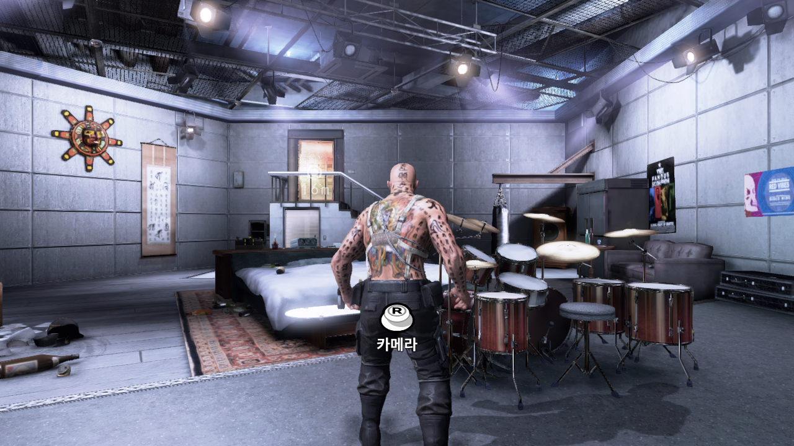
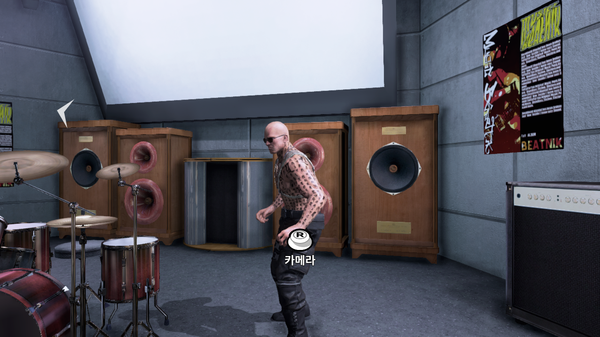
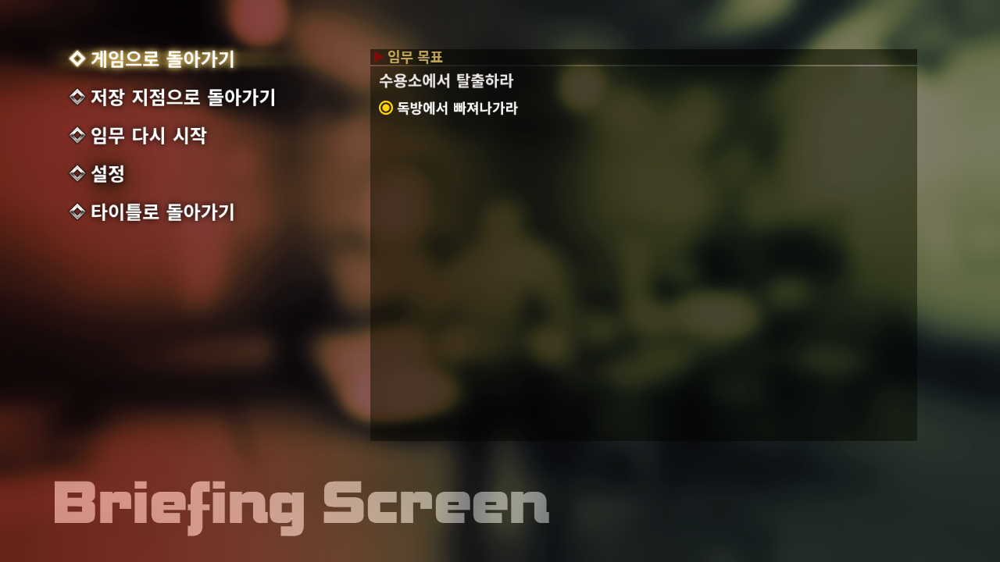

# WiiU-Devils-Third-Kr



**데빌즈 서드 (Devil's Third) Wii U 일본판 한국어 패치 · v0.8**

> **지원 원본: `Devils Third (10197D00) (Japan)` — Wii U 일본판 v0 전용입니다.**
> 다른 지역판·버전이나 임의 수정본은 지원하지 않습니다. ZIP 자동형은 내부 원본 데이터와 복호화된 2,556개 파일을 검사하며, 폴더형은 타이틀 ID·버전과 패치 대상 파일의 SHA-256을 검사합니다.

> **게임 내 언어를 Japanese / 日本語(일본어)로 설정해야 한글이 표시됩니다.**
> 일본어 데이터를 한국어로 교체한 패치입니다. Cemu의 **Console language도 Japanese**로 설정하고, 게임 안에서 **자막을 켜 주세요.**

## 다운로드

[**v0.8 한글 패처 다운로드**](https://github.com/OldManCraveGuitars-bit/WiiU-Devils-Third-Kr/releases/tag/v0.8)

| 패처 | 선택할 파일 | 용량 |
| --- | --- | --- |
| **[ZIP 자동형 — 권장](https://github.com/OldManCraveGuitars-bit/WiiU-Devils-Third-Kr/releases/download/v0.8/WiiU-Devils-Third-Kr-v0.8-ZIP.exe)** | 받은 원본 일본판 `.zip` 하나 | **993,229,692바이트 · 약 993 MB** |
| [폴더 선택형](https://github.com/OldManCraveGuitars-bit/WiiU-Devils-Third-Kr/releases/download/v0.8/WiiU-Devils-Third-Kr-v0.8.exe) | 이미 `code/content/meta`가 있는 게임 폴더 | 991,770,239바이트 · 약 992 MB |

두 EXE 모두 Windows 10/11 64비트용입니다. Python이나 별도 패치 프로그램은 필요하지 않습니다. 한글화 결과는 같습니다.
**원본 일본판 v0 전용**이며, 게임 전체 파일은 포함하지 않습니다. 원본 게임을 별도로 준비해야 합니다.

## 원본 ZIP 하나로 적용하기 — 권장

1. **`WiiU-Devils-Third-Kr-v0.8-ZIP.exe`**를 실행합니다.
2. **ZIP 선택**에서 `Devils Third (10197D00) (Japan).zip`을 선택합니다. **직접 압축을 풀 필요가 없습니다.**
3. **한글 게임 만들기**를 누릅니다.
4. 압축 해제·복호화·원본 검사·한글 패치가 자동으로 진행됩니다.
5. 완료되면 원본 ZIP 옆에 **`Devils Third (10197D00) (Japan) [Kr v0.8]`** 게임 폴더가 생깁니다. 저장 위치를 바꿀 수도 있습니다.
6. 결과 폴더를 Cemu 게임 경로로 등록하거나, 그 안의 `code/DevilsThirdGameNT-WiiU-Shipping.rpx`를 실행합니다.

원본 ZIP은 변경하지 않습니다. 결과 게임과 작업 공간으로 **약 20 GB의 여유 공간**이 필요합니다. Android에서는 만들어진 게임 폴더의 `code`, `content`, `meta`를 기기로 복사해 등록하세요.

**실행 후에는 반드시 게임 내 언어를 Japanese / 日本語로 바꾸고 자막을 켜 주세요.**

## 이미 게임 폴더가 있을 때 — 폴더 선택형

1. Cemu에서 게임을 종료합니다.
2. EXE 패처를 실행하고 **폴더 선택**을 누릅니다.
3. `code`, `content`, `meta`가 들어 있는 **복호화된 일본판 게임 폴더**를 선택합니다.
4. **한글 패치 적용**을 누르고 완료될 때까지 기다립니다.
5. Cemu의 **Console language → Japanese**로 설정합니다.
6. **게임 내 언어(Language) → Japanese / 日本語**로 설정합니다. 이 설정에서 한국어 문구가 나옵니다.
7. **게임 내 자막을 켜기(On)**로 설정합니다. 싱글 플레이 도입 영상의 자막도 이 설정을 따릅니다.

지원 원본은 **`Devils Third (10197D00) (Japan)` / Wii U 일본판 v0 / 타이틀 ID `0005000010197D00`**입니다.
폴더 선택형 EXE는 암호화된 `.app`, WUD/WUX 또는 ZIP을 직접 처리하지 않습니다. 받은 ZIP만 있다면 위의 **ZIP 자동형**을 사용하세요.

압축 안에 `00000000` 같은 숫자 파일들과 `tmd.0`만 있는 경우는 암호화된 설치 데이터입니다. **ZIP 자동형이 복호화까지 처리하여 `code/content/meta`를 생성합니다.** 다른 지역판이나 WUD/WUX용 자동 변환 기능은 아닙니다.

패처는 파일을 검사한 뒤 변경 파일을 준비·검증하고 백업 후 교체합니다. 백업은 게임 폴더의 `.DevilsThirdKR-backup`에 보관하며, **패치 전 복원** 버튼으로 되돌릴 수 있습니다.

## v0.8 내용

- 현재 제작된 메뉴·대사·기존 자막 등 **6,740개 문구**와 한글 글꼴을 반영했습니다.
- 로딩 안내·설명 등을 포함한 **한글 영상 90개**를 반영했습니다.
- 전투 전후 나레이션·브리핑에서 영어를 가리던 **덧씌우기 영상 13개는 원본으로 복원**했습니다. 기존 한글 대사 자막은 유지합니다.
- 캐릭터·문신·배경·소품 등 **게임 그림 텍스처는 원본을 유지**합니다.
- 원본 일본판 전용 구성과 글꼴 패키지 저장 방식 개선으로 이전 배포 준비본 대비 **28.55%** 용량을 줄였습니다. 한글화 내용과 영상 품질, 최종 게임 파일은 같습니다.
- **ZIP 자동형 추가:** 원본 ZIP 선택만으로 실행용 한글 게임 폴더를 생성합니다. 직접 압축을 풀거나 복호화 도구를 사용할 필요가 없습니다.

**v0.8은 부분 한글 패치입니다.** 무자막 음성의 새 자막 추가와 전체 플레이 구간 검수는 완료되지 않았습니다.

## Android Cemu 테스트 환경

| 항목 | 테스트 환경 |
| --- | --- |
| 기기 | Retroid Pocket Nova · Snapdragon 8 Gen 2 / Adreno 740 |
| 운영체제 | Android 13 |
| 에뮬레이터 | **Cemu Android v0.5.2** |
| 그래픽 드라이버 | **Custom driver 24.3.0** · Turnip / 로그 표기 `Mesa 24.3.0-devel` |
| 게임별 CPU 설정 | **Single-core recompiler** |

위 환경에서 사용자 플레이 테스트를 진행했습니다. Multi-core에서 게임이 종료되는 증상이 있었고, **Single-core recompiler로 변경한 뒤 정상 플레이가 보고됐습니다.** 전체 구간 검증 결과를 뜻하지는 않습니다.

설정 경로: **Cemu 게임 목록 → 데빌즈 서드 길게 누르기 → Edit game profile → CPU mode → Single-core recompiler**. 변경한 뒤 게임을 다시 실행합니다.

Android에서 사용할 때는 PC에서 패치한 게임의 `code`, `content`, `meta` 폴더를 기기로 복사하세요. 백업 폴더까지 복사할 필요는 없습니다.

## 스크린샷

아래는 **PC Cemu에서 저장한 실제 게임 화면**입니다.

### 메인 메뉴



### 싱글 플레이 메뉴



### 인게임 안내



### 영상 대사 자막



### 조작 안내와 플레이 화면





### 일시정지 메뉴와 임무 목표



타이틀 대표 이미지를 포함해 총 **8장**이며, 모두 가상패드 오버레이가 없는 PC 게임 화면입니다.

## 원본 및 배포 파일 해시

- **ZIP 자동형 원본 검사:** 지원하는 TMD·ZIP 내부 데이터 및 복호화한 **2,556개 게임 파일의 SHA-256**을 확인합니다.
- **폴더형 타이틀 ID / 버전 검사:** `0005000010197D00` / v0.
- **폴더형 원본 파일 검사:** 패치 대상 116개 경로의 SHA-256을 확인합니다. 같은 폴더 이름이어도 내부 데이터가 다르면 적용하지 않습니다.
- **완성 파일 검사:** 만들어진 한글 파일이 정해진 SHA-256과 일치하는지 확인한 뒤 교체합니다.
- **EXE 확인:** 릴리스의 `SHA256SUMS.txt`로 다운로드 파일을 확인할 수 있습니다.
- [지원 원본 파일 SHA-256 목록](ORIGINAL_FILE_HASHES_SHA256.txt) · [적용 후 파일 SHA-256 목록](PATCHED_FILE_HASHES_SHA256.txt)

ZIP 자동형 EXE SHA-256:

```text
59a42a90789ff9c66f07f53421d232eb95d4fdef95148989d3d51846359684f2
```

폴더형 EXE SHA-256:

```text
3db91bc92a9c0bb8293f6d49e710ccd50e9f658f9652ba8e1bbe98fa4072d1db
```

확인된 원본 ZIP의 SHA-256은 [SOURCE_ZIP_SHA256.txt](SOURCE_ZIP_SHA256.txt)에 별도로 기록했습니다. 원본 ZIP 자체는 배포하지 않습니다.

## 검증 및 문의

ZIP 자동형은 실제 제공된 약 15 GB 원본 ZIP으로 전체 변환을 실행해 **2,556개 게임 파일이 기존 검증본과 모두 일치**하는 것을 확인했습니다. 원본 ZIP은 변경되지 않았습니다. 잘못된 ZIP·취소·공간 부족·기존 폴더 보호 등 7개 테스트도 통과했습니다.

폴더형은 실제 EXE로 원본 일본판 적용, 재적용 시 건너뛰기, 패치 전 복원을 시험했습니다. 최신 한글판과 **116개 대상 파일의 해시가 일치**하며, 지원하지 않는 이전 덧씌우기판을 선택하면 게임 파일을 교체하지 않고 중단합니다.

다운로드 파일 확인에는 릴리스의 `SHA256SUMS.txt`를 사용하세요. 문제를 제보할 때는 진행 구간, 화면과 Cemu 버전·드라이버 정보를 함께 적어 주세요.

게임의 권리는 원저작권자에게 있습니다. 사용한 구성 요소와 한글 글꼴의 라이선스는 [LICENSES](LICENSES)를 참고하세요.
